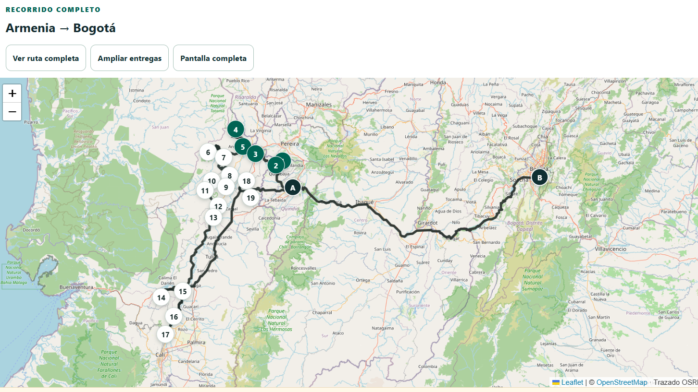
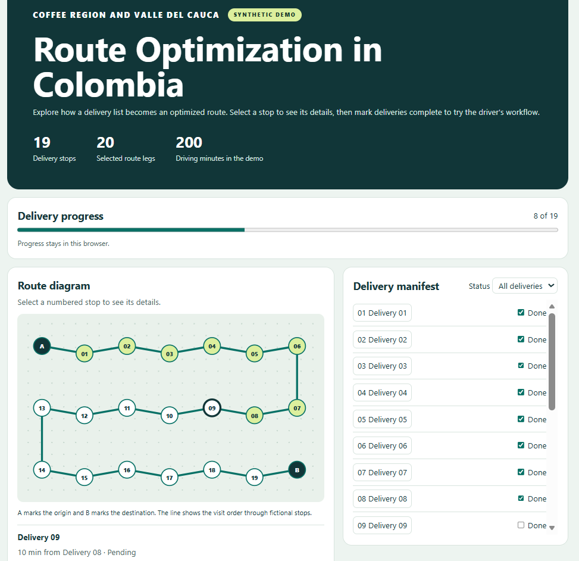

# Route Optimization in Colombia

**Coffee Region and Valle del Cauca**

A logistics engineering case study on optimizing a delivery route from Armenia in Colombia’s Coffee Region, through 19 municipalities in Valle del Cauca, to Bogotá. The repository includes an interactive demo with synthetic data.



*Earlier driver-facing application, showing the numbered stops and the OSRM road trace. Map data © [OpenStreetMap contributors](https://www.openstreetmap.org/copyright).*

## Case study at a glance

The Colombian case involved one truck, 19 deliveries, 1,007 water filters, a fixed departure in Armenia, and a fixed finish in Bogotá. The modular run evaluated 380 directed legs and produced a route with 1,549.02 minutes of estimated driving and a 0% solver gap. On the same travel-time matrix, the new visit order reduced estimated driving by 5 min 43 s compared with the previous order. These figures describe the model and its saved input costs. Actual trip times were outside that comparison.

## My contribution

I implemented a modular route-planning workflow in four stages: geocoding delivery addresses, building a directed travel-time matrix, solving for the visit order with Pyomo and HiGHS, and deploying an interactive route viewer to Netlify. I reviewed the delivery coordinates before generating the matrix and evaluated both the previous and optimized visit orders using the same travel-time estimates. I documented the mathematical model and the steps needed to reproduce the result.

## Workflow

| Stage | Input | Output |
| --- | --- | --- |
| 01 Geocoding | Delivery addresses and endpoint references | Reviewed coordinates and stable node IDs |
| 02 Travel-time matrix | 21 geocoded nodes | Estimated minutes and kilometers for 380 directed legs |
| 03 Optimization | Fixed endpoints, nodes, and travel times | Visit order and HiGHS solve report |
| 04 Web app | Ordered stops and delivery information | Static map and delivery checklist served through Netlify |

Google Geocoding and Routes API supplied inputs in the operational project. Pyomo formulates the asymmetric traveling salesman path problem. HiGHS solves it. The web interface uses the precomputed results.

## Run the synthetic example



*The synthetic demo uses fictional stops and travel times. This example shows 8 of 19 deliveries marked complete.*

Use Python 3.14. In PowerShell, from the repository root:

```powershell
python -m venv .venv
.\.venv\Scripts\python.exe -m pip install -r requirements.txt
.\.venv\Scripts\python.exe .\03-optimization\optimizar_ruta.py
```

Dependency installation needs internet access. Running the optimizer uses the included synthetic files and makes no Google API calls. It writes `ruta_optima.csv` and `resultado_atsp.json` under `03-optimization`. The demo has the same 21-node structure as the case. Its coordinates, costs, and stop labels are fictional.

Open `04-web-app/index.html` in your browser to explore the synthetic solution. Select a numbered stop, mark deliveries complete, and filter the manifest by status. The route diagram shows the visit order. It uses fictional locations, no external map tiles, and no API keys.

## What to inspect

- [Mathematical model and implementation](docs/model.md)
- [Original optimizer](03-optimization/optimizar_ruta.py)
- [Matrix acquisition and validation code](03-optimization/construir_matriz.py)

The public example excludes operational addresses, credentials, and Google-derived datasets. The case-study numbers and synthetic demo are reported separately.


